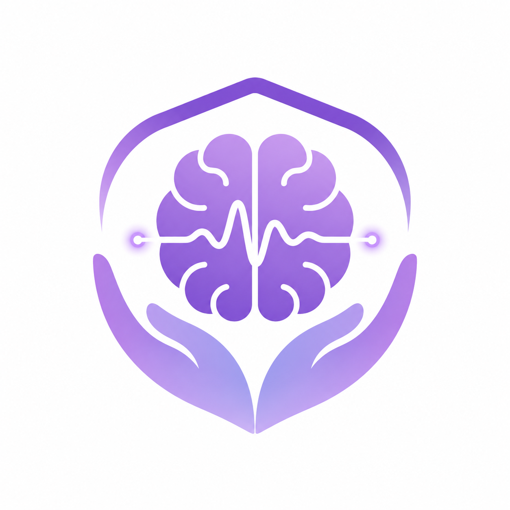

<div align="center">
  
  <h1>Aura</h1>
  <p><em>Diario locale per crisi epilettiche e aure, pensato per registrare subito ciò che si ricorda e trasformarlo in un report utile al medico.</em></p>
</div>

---

## Perché esiste (le motivazioni)

Aura nasce da un'insoddisfazione concreta con le app di diario per l'epilessia esistenti
(es. *Epilepsy Journal*). Sono ottimi archivi e generano bei report, ma falliscono
proprio nel momento più delicato — e più clinicamente prezioso: **i minuti dopo una
crisi**, quando la persona è confusa, stanca, a volte amnesica.

Due difetti, in particolare, hanno spinto a costruire un'interfaccia diversa:

1. **La registrazione presuppone una persona lucida.** Ti mettono davanti un *form da
   compilare*, con pulsanti da premere e campi da riempire. Ma chi ha appena avuto una
   crisi non è nelle condizioni di farlo con precisione. Serviva l'opposto: una
   registrazione **assistita, contestuale e rimandabile** — cattura *dove, come, cosa
   stava succedendo* con il minimo sforzo, e permetti di completare i dettagli dopo.

2. **La tassonomia delle crisi è troppo medica.** Le app chiedono di scegliere fra
   termini clinici ("crisi focale con compromissione della coscienza", "assenza",
   "mioclonica"…) difficili da mappare su ciò che si è realmente vissuto. Serviva far
   descrivere in **linguaggio naturale** ("mi sono irrigidito", "fissavo il vuoto",
   "scatti al braccio", "morso alla lingua") e lasciare che sia il **sistema a tradurre**
   verso la categoria clinica per il medico.

> **ILAE 2017** = *International League Against Epilepsy*, edizione 2017: la
> classificazione ufficiale e più diffusa dei tipi di crisi epilettiche. Organizza ogni
> crisi per **esordio** (focale / generalizzato / non determinato), **coscienza**
> (conservata / compromessa) e **componente motoria o meno**. È il "linguaggio" che il
> neurologo riconosce, ed è la mappa verso cui Aura traduce le descrizioni in parole comuni.

Da qui i **due principi non negoziabili** dell'interfaccia:

> **1. Registrazione post-crisi assistita** — non un modulo, ma un flusso guidato: una
> domanda per schermata, pulsanti grandi, "Non ricordo / salta" ovunque (l'amnesia è un
> dato valido, non va forzato), tutto completabile in un secondo momento. Cattura in un
> tocco: l'evento esiste già, con data e ora, senza compilare nulla.
>
> **2. Tassonomia in linguaggio naturale** — l'utente parla umano, il medico legge
> clinico. La traduzione verso la classificazione **ILAE 2017** è sempre presentata come
> *proposta da confermare col medico*, **mai come diagnosi**.

## Il cuore: un traduttore linguaggio → clinica

Il pezzo centrale non è la UI, è un **motore di traduzione** deterministico (Dart puro,
nessuna rete, nessun LLM a runtime). Ogni descrizione in linguaggio naturale porta delle
*spinte pesate* verso le dimensioni ILAE (esordio, coscienza, componente motoria) e verso
un sottotipo; il motore le aggrega e propone una categoria con una **confidenza**, il
**razionale** (quali descrizioni l'hanno guidata) e le **alternative** plausibili.

La filosofia è ereditata dal progetto gemello **Wordsound**: **probabilistico, non
dogmatico**. Il sistema *propone*, non impone; quando il dato è povero degrada in modo
pulito (confidenza bassa, nessun sottotipo forzato); le alternative sono sempre esposte.
Lo stato d'animo resta un dato importante di contesto/trigger e viene riportato
nel diario per il medico; non viene però usato da solo per decidere il tipo ILAE
della crisi.

## Funzionalità

- **Quick-capture** in un tap dalla home (data/ora automatiche, dettagli rimandabili).
- **Registrazione aura separata** dalla crisi: umore, tipo di aura, durata a scaglioni
  e confusione/presenza, senza forzare una diagnosi.
- **Contesto farmaci** opzionale e non colpevolizzante: se l'utente ricorda una dose
  saltata o ritardata, può indicare quando e quante dosi.
- **Flusso guidato** in linguaggio quotidiano: stato d'animo → preavviso/aura → corpo →
  coscienza → dopo. Chip grandi, "Non ricordo / salta" su ogni schermata.
- **Proposta clinica** con % di confidenza, alternative e avviso "non è una diagnosi".
- **Calendario** mensile (in italiano) con i giorni segnati e gli episodi del giorno;
  salto rapido a *oggi*.
- **Elenco/report** leggibile per il medico: data a sinistra, descrizione completa a
  destra (stato d'animo, sintomi, categoria proposta).
- **Export PDF** condivisibile (email, ecc.) con tabella cronologica e disclaimer.
- **Eliminazione con conferma** (cestino) da elenco, calendario e pagina evento.
- **Persistenza locale cifrata on-device**: gli eventi sopravvivono alla chiusura
  dell'app e il JSON non resta salvato in chiaro.
- Palette **viola** — colore della consapevolezza sull'epilessia.

## Struttura del repository

```
lib/
  main.dart                     # entry point, tema (viola, accessibilità), avvio + load
  model/
    ilae.dart                   # enum/classi ILAE 2017 (semplificato) + etichette cliniche
    descriptor.dart             # descrittore in linguaggio naturale + hint pesati
    seizure_event.dart          # evento crisi/aura (+ serializzazione JSON)
  data/
    descriptor_catalog.dart     # tabella statica curata: parole → spinte cliniche
    event_repository.dart       # store in memoria + persistenza cifrata
  engine/
    seizure_classifier.dart     # media pesata → classe + confidenza + alternative (Dart puro)
  services/
    encrypted_event_store.dart  # cifratura AES-GCM + migrazione storage v1
    report_pdf.dart             # generazione del PDF per il medico
  ui/
    home_screen.dart            # quick-capture crisi/aura + eventi recenti
    capture_flow_screen.dart    # flussi guidati + proposta/riepilogo
    calendar_screen.dart        # calendario mensile + episodi del giorno
    report_screen.dart          # elenco leggibile + export PDF
    dialogs.dart                # conferma eliminazione
test/
  seizure_classifier_test.dart  # test del motore di traduzione
assets/icon/logo.png            # logo (icona app + favicon web generate da qui)
```

Il **catalogo dei descrittori** si estende in `data/descriptor_catalog.dart`, non altrove
(è l'equivalente del dizionario di Wordsound). Il motore (`engine/`) è puro e testabile in
isolamento, separato dalla UI.

## Come si lancia

```sh
# prerequisito: Flutter (include il Dart SDK)
flutter pub get

# test del solo motore (veloce, nessun device)
flutter test

# eseguire l'app in sviluppo nel browser
flutter run -d chrome

# preview dal telefono sulla stessa Wi-Fi
flutter run -d web-server --web-hostname 0.0.0.0 --web-port 8080
#   poi dal telefono: http://<IP-del-Mac>:8080

# generare l'APK Android installabile
flutter build apk --release
#   output: build/app/outputs/flutter-apk/app-release.apk

# rigenerare icona app + favicon dopo aver cambiato il logo
dart run flutter_launcher_icons
```

## Privacy

Tutti i dati restano **sul dispositivo**: nessun server, nessuna rete, nessun account. Il
diario viene salvato localmente come payload cifrato con AES-GCM; la chiave è custodita
nel secure storage della piattaforma (Android Keystore su Android). Se l'app trova dati
di una versione precedente salvati in chiaro, li migra automaticamente al nuovo formato
cifrato.

## Stato e roadmap

Fatto:

- [x] Motore di traduzione linguaggio → ILAE (Dart puro, testato)
- [x] Flusso di registrazione guidato assistito + stato d'animo
- [x] Registrazione aura autonoma con tipo, durata e confusione
- [x] Contesto farmaci saltati/ritardati nel flusso guidato
- [x] Calendario mensile + elenco/report leggibile
- [x] Export PDF per il medico
- [x] Eliminazione con conferma
- [x] Persistenza locale on-device
- [x] Cifratura a riposo degli eventi salvati
- [x] Icona app + favicon + palette viola

Prossimi passi:

- [ ] Input vocale nel flusso guidato ("racconta cosa ricordi")
- [ ] Diario farmaci + promemoria
- [ ] Modalità testimone (per chi assiste alla crisi)
- [ ] Contesto automatico (sonno, ciclo, trigger) per l'analisi dei pattern

## Disclaimer

Aura **non è un dispositivo medico** e **non fornisce diagnosi**. Le categorie cliniche
sono derivate automaticamente dalle descrizioni dell'utente come supporto al colloquio con
il medico. Ogni decisione clinica spetta al neurologo.
